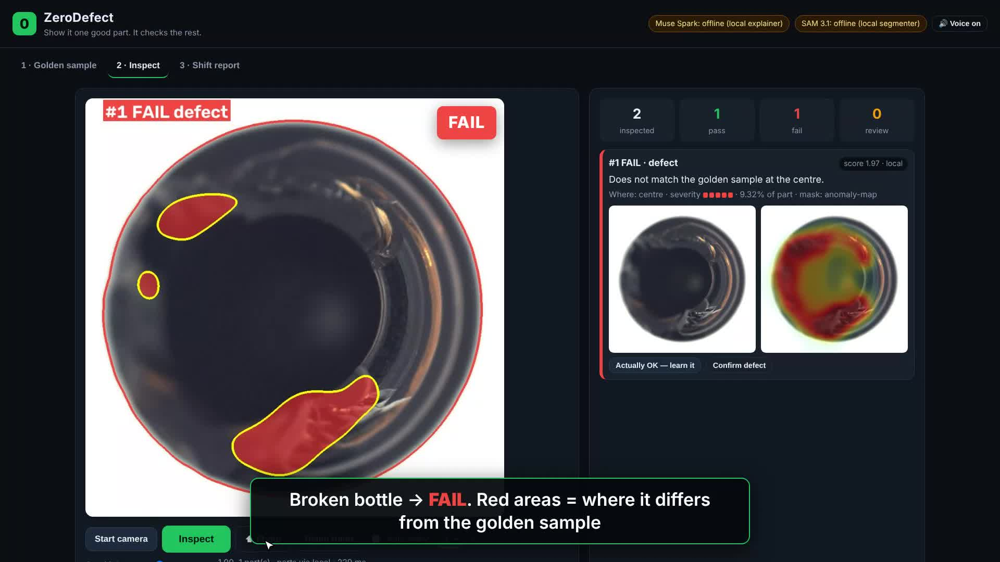
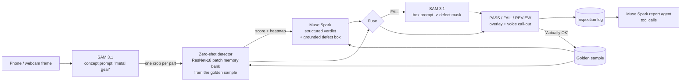

# ZeroDefect

**AI quality inspection for small factories. Show it one good part and it checks the rest, using just a phone camera.**

**Author:** Monashini ([@Monashini](https://github.com/Monashini)) · **Demo video:** https://youtu.be/V-uBvXXySCs

Built for the **Meta Global AI Developer Hackathon** (Theme: *Push the Frontier – manufacturing*) with **Muse Spark** and **SAM 3.1** on Meta Model API.



## The problem

Industrial estates like Ambattur, Guindy and Sriperumbudur in Chennai are full of small units that make bolts, gears, washers, bottles, PCBs and garment pieces. Quality checking there means a person staring at parts for 8 hours. Defects get missed, and whole batches come back rejected.

Machine-vision systems cost lakhs of rupees. They also need thousands of labelled defect photos, which a small factory doesn't have.

## What ZeroDefect does

1. **Show it one good part.** The owner puts a perfect "golden sample" in front of a phone or webcam. That's the whole setup: no training data and no defect photos.
2. **SAM 3.1 finds every part** in the frame from a plain phrase like "metal gear". It handles several parts on a table or belt at once.
3. **A zero-training anomaly detector** compares each part with the golden sample, patch by patch, and makes a heatmap of anything that looks different.
4. **Muse Spark inspects like a senior QC supervisor.** It looks at the golden sample, the part and the heatmap together. It ignores glare and pose, names the defect (scratch, crack, missing hole, stain, chipped edge…), says where it is in plain words, rates severity and suggests a likely process cause.
5. **SAM 3.1 outlines the defect exactly.** Muse Spark's rough defect box becomes a box prompt for SAM 3.1, which returns a pixel-accurate defect mask. ZeroDefect then reports the defect as a % of the part's area.
6. **Green/red PASS–FAIL plus a voice call-out**, for example *"Crack near the bore, reject."*, so the operator doesn't have to look at a screen.
7. **It learns from the operator.** Tapping "Actually OK – learn it" adds that part to the golden set, so false alarms go down over the shift.
8. **Shift report agent.** Muse Spark uses tool calls to query the inspection log (summary, defects by hour, defect breakdown, recent failures). It looks for patterns and writes an action list, for example *"most cracks after 3 PM – check the machine temperature."*

## How Meta's models are used

| Step | Model | How |
|---|---|---|
| Find all parts in a frame | **SAM 3.1** (`sam-3.1`) | Concept prompt with the product's noun phrase. Streamed boxes + masks are parsed with `meta-sam-parser`. |
| Judge each part | **Muse Spark** (`muse-spark-1.3`) | 3-image multimodal prompt (golden, part, heatmap) + **structured output** (JSON schema: verdict, defect type, 0–1000 grounded bbox, severity, confidence, explanation, voice call-out, likely cause). |
| Outline the defect | **SAM 3.1** | **Box prompt** built with `build_object_prompt` from Muse Spark's grounded box → pixel-accurate defect mask → defect area %. |
| Shift report | **Muse Spark** | **Tool-calling agent** loop over the inspection database. |

Muse Spark *grounds* the defect and SAM 3.1 *segments* it, so the two models work as a chain. ZeroDefect also combines two independent opinions: the detector's score and Muse Spark's verdict. When they disagree, the part goes to **REVIEW** for a human instead of being guessed.

Without an API key, or if the network drops, every step falls back to a local method. These are classical segmentation, the heatmap-based explainer and a template report, so the line keeps running.

## Architecture



The **detector** is PatchCore-style and uses no training. A frozen ImageNet ResNet-18 (ONNX, CPU) turns the golden sample into a memory bank of local patch features. To get a range of normal looks from a single photo, ZeroDefect augments that photo with small shifts, rotations, lighting changes and phone-camera noise/JPEG artefacts. A part's anomaly map is each patch's distance to its nearest "good" patch.

The pass/fail line is set automatically from held-out augmented views. You can also set it from 3–5 extra OK parts ("calibrate"), and there's a sensitivity slider. The detector runs on CPU in about 0.1 s per part.

## Results

### ZeroDefect-Synth (reproducible, included)

The procedurally generated parts are a gear, a brass washer and a PCB-like bracket. Each has 5 defect types, with random pose, lighting and sensor noise. The test used **1 golden sample per part, 0 defect images**, 3 golden samples × 80 test parts per part type.

| part | image AUROC | recall (auto / +4 OK parts) | false alarms (auto / +4 OK parts) |
|---|---|---|---|
| gear | 0.982 | 73% / 71% | 2% / 1% |
| washer | 0.993 | 90% / 99% | 0% / 6% |
| bracket | 0.996 | 78% / 98% | 0% / 5% |
| **all** | **0.990** | 80% / 89% | 1% / 4% |

Recall by defect type (calibrated): stain 100%, chipped edge 92%, missing hole 89%, crack 86%, scratch 79%.
Reproduce with `python benchmark/synth_eval.py`.

### MVTec AD "bottle" (real factory images, standard public benchmark)

The test used **1 golden image and 0 defect images**, on the full bottle test set: 20 good, 63 defective (broken large, broken small, contamination).

| golden images | image AUROC | pixel AUROC |
|---|---|---|
| 1 | **0.993** | **0.983** |
| 2 | 1.000 | 0.982 |
| 4 | 0.998 | 0.983 |

Through the full app pipeline (segmentation, crop, detector) with 1 golden bottle plus 4 OK bottles for calibration, the app **caught all 63 defective bottles and flagged 1 of 20 good bottles.**

### MVTec AD "metal nut"

This test used 1 golden image with rotation-invariant mode on, on the scratch and colour defect images (45 defective, 22 good).

| golden images | image AUROC | pixel AUROC |
|---|---|---|
| 1 | **0.931** | **0.951** |
| 4 | 0.949 | 0.967 |

Through the full app pipeline (1 golden nut plus 4 OK nuts for calibration, sensitivity 1.15), the app caught **36 of 45 defective nuts and flagged 0 of 22 good nuts**.

Reproduce with `python benchmark/mvtec_eval.py --root <mvtec_root> --categories bottle,metal_nut --shots 1 2 4`. The results are in `benchmark/results_mvtec_*.json`. The images are MVTec AD (Bergmann et al., CVPR 2019), CC BY-NC-SA 4.0, and are not included in this repo.

## Run it

Needs Python 3.10+.

```bash
git clone <this repo> && cd zerodefect
cp .env.example .env        # paste your MODEL_API_KEY from https://dev.meta.ai
./run.sh                    # Windows: run.bat
# open http://localhost:8000
```

`run.sh` installs the requirements, downloads the 45 MB ResNet-18 ONNX backbone (`scripts/download_model.py`) and starts the server.

- **Check your key:** `python scripts/check_api.py` calls Muse Spark and SAM 3.1 once on a demo frame.
- **No camera?** Click *Use demo part* and then *Demo frame*. Procedural conveyor frames with random defects are generated on the fly.
- **Phone as the camera:** open `http://<laptop-ip>:8000` on the phone. Browsers only allow the live camera on `https`/`localhost`. Over plain LAN http, the *Photo* button still opens the phone camera directly.
- **Offline mode:** leave `MODEL_API_KEY` empty (or set `ZD_OFFLINE=1`).
- **Tests:** `pip install pytest httpx && pytest -q`. This covers the detector, SAM 3.1 wire-format parsing, a mocked Meta Model API end-to-end run, API-failure fallback and the HTTP API.

## Project layout

```
zerodefect/
  detector.py   zero-training golden-sample anomaly detector (ONNX ResNet-18, PatchCore-style)
  meta_api.py   SAM 3.1 (concept + box prompts, stream parsing) and the Meta Model API client
  inspector.py  Muse Spark structured inspection + offline explainer + verdict fusion
  pipeline.py   end-to-end engine: parts -> score -> verdict -> defect mask -> log
  report.py     Muse Spark tool-calling shift-report agent (+ offline report)
  store.py      SQLite inspection log and analytics
  server.py     FastAPI REST API, serves the web UI
  synth.py      procedural parts and defects for demos, tests and the benchmark
web/            operator UI (vanilla JS, mobile-friendly, voice call-outs)
benchmark/      MVTec AD and ZeroDefect-Synth evaluation scripts
scripts/        model download, API check
tests/          pytest suite
```

## Built during the hackathon

All code in this repository was written during the hackathon building period (Oct 27 – Nov 4, 2026). The application idea was submitted with the hackathon application. Third-party components are the ONNX Model Zoo ResNet-18 weights (Apache-2.0), downloaded at setup and not stored in the repo, plus the open-source Python packages listed in `requirements.txt`.

## Author

**Monashini** · [github.com/Monashini](https://github.com/Monashini)

## License

MIT © 2026 Monashini
